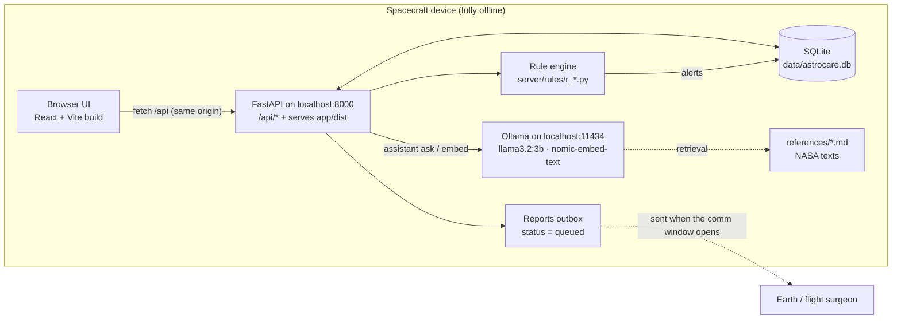

# Architecture

**Browser UI.** React 18 + TypeScript, built by Vite into static files. Routing uses `react-router-dom`, charts use Recharts, icons use `lucide-react`, and fonts come from `@fontsource`, so everything is bundled and nothing is fetched from the internet. `AppShell` holds the `SideNav` and the `OfflineStatusBar` (mission, comms, MET clock, from `/api/status` every 30 s). Feature pages live in `app/src/features/<pair>` and only talk to the backend through `shared/api/client.ts` (relative `/api` paths).

**FastAPI on localhost.** One Python process (`server/main.py`). Each pair has its own router in `server/features/<name>/router.py`, mounted under `/api`. In demo mode (`npm run start`) the same process serves `app/dist`, with an SPA fallback to `index.html`, so the whole app is one offline process on port 8000. In development, Vite (port 5173) proxies `/api` to it.

**SQLite.** One file, `data/astrocare.db`, created on startup if missing (`server/core/db.py`, standard `sqlite3`). There is one table per contract type, and list/dict fields are stored as JSON text. On first start, `core/seed.py` runs `core/simulator.py` to fill 14 days of simulated data for Crew Member 2, with the demo scenario built in. Later, `core/adapter.py` will map the hackathon dataset (`data/raw/`) into the same tables with `source = "dataset"`.

**Rule engine.** `server/rules/engine.py` imports every `r_*.py` module, runs each `Rule.evaluate(ctx)` against a `RuleContext` (readings by metric and window, cabin, sleep, tests, check-ins, profile, resources, thresholds, now), and stores the resulting alerts. It skips a duplicate while the earlier alert is still open. It runs on startup. Thresholds come from `config/thresholds.yaml`, and each one has a source.

**Ollama (local LLM).** Runs on the same device at `localhost:11434`. The assistant router will embed `references/` with `nomic-embed-text` and answer with `llama3.2:3b`, citing its sources. It refuses medication and dose questions. For now `/api/assistant/ask` is a stub, and `/api/assistant/info` reports whether Ollama is reachable.

**Reports outbox → Earth link.** Reports are created locally (`/api/reports`, PDF via ReportLab later) and wait with `status = "queued"`. The comm-window schedule in `config/app.yaml` drives the "Next comm window" countdown. When a window opens, queued reports are marked `sent` (sync is simulated in the demo; the app never makes a real network call).
